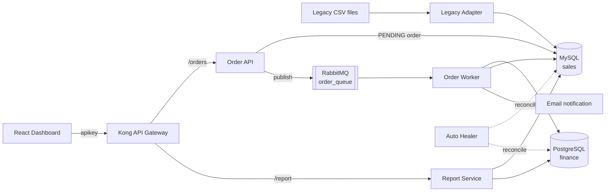

# NOAH — Unified Commerce System

An event-driven microservices system that moves retail data from a legacy system (CSV files) into a modern architecture. Orders are accepted through an API gateway, queued in **RabbitMQ**, processed asynchronously, and kept in sync across two databases: **MySQL** for sales and **PostgreSQL** for finance.

     

## Architecture



### Order flow

1. The client sends an order through **Kong** (API-key authentication, 100 requests/minute rate limit).
2. **Order API** checks the product and stock, saves the order as `PENDING` in MySQL and publishes it to RabbitMQ. It returns `202 Accepted` immediately.
3. **Order Worker** consumes one message at a time (`prefetch_count=1`), writes the transaction to PostgreSQL, updates MySQL and sends an HTML email. Messages are acknowledged only after success; failures are re-queued. Database connections are retried on startup.
4. **Report Service** aggregates data from both databases for the dashboard.
5. **Auto Healer** (optional) periodically compares both databases, copies missing records to the other side and logs every repair.

## Services

| Service          | Tech                     | Responsibility |
|------------------|--------------------------|----------------|
| `order-api`      | FastAPI, Pydantic        | Validate and accept orders, publish to queue |
| `order-worker`   | Python, pika             | Consume orders, sync MySQL ↔ PostgreSQL, send email |
| `report-service` | FastAPI, pandas          | Revenue, stats and product reports |
| `legacy-adapter` | Python                   | Import inventory CSV files into MySQL, skip invalid rows |
| `auto-healer`    | Python                   | Detect and repair inconsistencies between databases |
| `dashboard`      | React, Vite, Tailwind CSS | Overview, orders, inventory, place orders |
| `kong`           | Kong (declarative config) | Routing, key auth, rate limiting, CORS |

## Getting Started

**Requirements:** Docker and Docker Compose. Ports `3000`, `8000`, `8001`, `15672`, `3307` and `5432` must be free.

```bash
cp .env.example .env
docker compose up --build -d
docker compose logs -f        # databases need ~30–60 s to initialise
```

Run the optional auto healer as well:

```bash
docker compose --profile healer up -d
```

### Endpoints

| Service       | URL                                   |
|---------------|---------------------------------------|
| Dashboard     | http://localhost:3000                 |
| API Gateway   | http://localhost:8000                 |
| Kong Admin    | http://localhost:8001                 |
| RabbitMQ UI   | http://localhost:15672 (guest/guest)  |
| MySQL         | `localhost:3307`                      |
| PostgreSQL    | `localhost:5432`                      |

### Try the API

```bash
# Place an order through the gateway
curl -X POST http://localhost:8000/orders/api/orders \
  -H "apikey: noah-secret-key" -H "Content-Type: application/json" \
  -d '{"user_id": 1, "product_id": 101, "quantity": 2}'

# Get statistics
curl http://localhost:8000/report/api/stats -H "apikey: noah-secret-key"
```

### Import legacy inventory

Copy a CSV file (`product_id,quantity`) into `legacy-adapter/input/`. The adapter imports it and moves it to `legacy-adapter/processed/`. A sample file is in [`legacy-adapter/sample-data/`](legacy-adapter/sample-data/inventory.csv).

### Load test

[`scripts/ingest_orders.py`](scripts/ingest_orders.py) pushes existing orders from MySQL into the queue in bulk:

```bash
pip install -r scripts/requirements.txt
RABBITMQ_HOST=localhost python scripts/ingest_orders.py
```

## Project Structure

```
noah_v2/
├── order-api/          # FastAPI order intake
├── order-worker/       # RabbitMQ consumer + auto healer
├── report-service/     # Reporting API
├── legacy-adapter/     # CSV import (input/, processed/, sample-data/)
├── dashboard/          # React dashboard
├── kong/               # Gateway declarative config
├── db/                 # MySQL and PostgreSQL init scripts
├── scripts/            # Utility scripts
├── docs/               # Technical specification (Vietnamese)
└── docker-compose.yml
```

## Troubleshooting

- **Services cannot connect to a database:** the databases start slower than the services. Wait a minute or run `docker compose restart`.
- **Port already in use:** stop whatever is using ports 3000 or 8000.
- **No data on the dashboard:** place an order or drop a CSV file into `legacy-adapter/input/`.

## Notes

The credentials in `.env.example` and `kong/kong.yml` are local development defaults. Change them before deploying anywhere.

## Authors

Course project for **CMU-CS 445**, Team 1. Repository maintained by **Huynh Thanh Sang** — [github.com/Gnas260605](https://github.com/Gnas260605).
